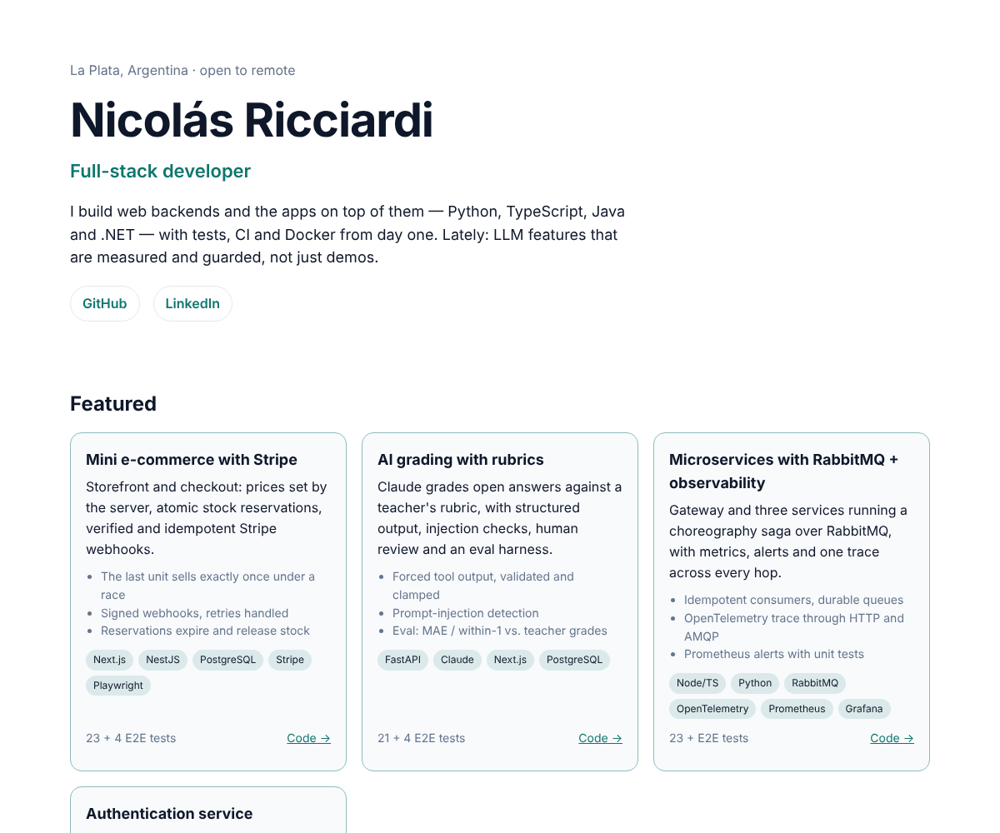
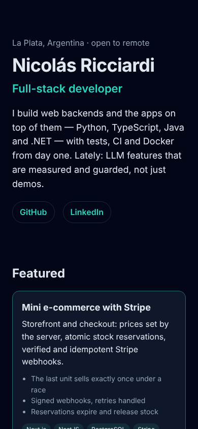

# Portfolio — Nicolás Ricciardi

My personal site: who I am and the projects I've built, with a filter by area and a search by technology. It's a fully static Next.js export: no server and no tracking, and it deploys anywhere.

| Desktop | Mobile (dark mode) |
|---|---|
|  |  |

## Edit the content

- `lib/profile.ts`: name, summary, links and education. Fill in the `TODO`s (email, CV, degree).
- `lib/projects.ts`: one entry per project. The slug is the repository name, so links point to `github.com/Nack34/<slug>`. Mark up to 4 as `featured`.

Unit tests check that every project is complete and that slugs are valid repository names. A typo breaks the build, not the site.

## Run, test, deploy

```bash
npm install
npm run dev                         # http://localhost:3000
npm test                            # data + filtering logic (Vitest)
cd e2e && npm install && npx playwright test   # the built site, desktop and mobile
```

**Deploy:**
- **GitHub Pages:** push to `main`. The workflow tests, builds with the right base path, and publishes. Enable it once under *Settings → Pages → Source: GitHub Actions*.
- **Vercel:** import the repository; no configuration needed.

## Tests

| Suite | What it covers |
|---|---|
| Vitest (5) | unique and valid slugs, complete entries, filtering by area and by text, technology counts |
| Playwright (4 × desktop and mobile) | hero and contact links, featured projects, area filter and search (including no results), every repository link, no horizontal overflow on mobile |

## License

MIT for the code. The text and project descriptions are mine.
